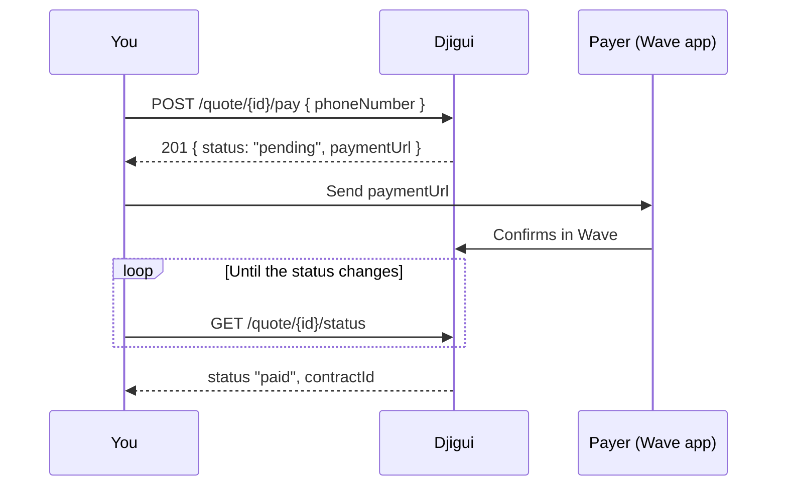

A quote is paid with Wave, by a phone number you choose: your client's, or your company's own. Once the payment is confirmed, the quote becomes a contract.

<Warning>
  In production, payments are real money. Test with the staging environment.
</Warning>

## The flow

1. **Open the payment** with [`POST /quote/{id}/pay`](/api-reference/quotes/pay) and the Wave number that will pay. Only that number can confirm it.
2. **Send `paymentUrl` to the payer.** It opens the payment in Wave. The payer has 30 minutes to confirm.
3. **Follow the quote** with [`GET /quote/{id}/status`](/api-reference/quotes/status) until the payment settles.

## What the payer is charged

| Field | |
| --- | --- |
| `amount` | The quote's premium. |
| `fees` | Wave's fee, added on top. |
| `chargedAmount` | What the payer is asked for: `amount + fees`. |

All in francs CFA.

## Knowing when it is paid

Djigui does not notify your systems yet: poll [`GET /quote/{id}/status`](/api-reference/quotes/status). Every few seconds is fine while you know the payer is confirming; slow down after a few minutes.

| Quote `status` | Meaning | What to do |
| --- | --- | --- |
| `awaiting_payment` | Never paid, or every attempt failed. | Open a payment. |
| `payment_pending` | Waiting for the payer to confirm in Wave. | Keep polling. `payment.paymentUrl` is still valid. |
| `paid` | Paid: the contract is open. | Follow the contract with `contractId`, or with [`GET /contract/quote/{quoteId}`](/api-reference/contracts/get-by-quote). |

`payment` in the status response is the latest attempt, with its `failureReason` when it failed.

Wave usually confirms within seconds. If its confirmation is lost on the way, Djigui asks Wave directly after a couple of minutes, so a paid quote never stays `payment_pending` for long. A payment the payer has not confirmed after 30 minutes is closed and marked `failed`.

## Failed payments

A failed payment can be followed by another: call [`POST /quote/{id}/pay`](/api-reference/quotes/pay) again, with the same number or another one.

If Wave cannot be reached when you open the payment, you get `502 payment_provider_unavailable`. The attempt is recorded as failed and you can retry.

## One payment at a time

A quote has at most one payment waiting or succeeded:

- Paying while a payment is waiting answers `409 payment_in_progress`, with the `paymentId` and `paymentUrl` of the one waiting. Send that URL to the payer again.
- Paying a paid quote answers `409 quote_already_paid`.

So you can retry a pay request safely: it never charges twice.

## Quotes that cannot be paid

- **Expired.** A quote can be paid for 24 hours after its creation, until its `expires`. After that, it answers `410 quote_expired`: create a new quote. A payment the payer is confirming when the 24 hours run out still counts. See [Quotes](/guides/quotes#expiry).
- **Cancelled.** A quote you cancelled answers `409 quote_cancelled`.
- **Start date passed.** A quote can be paid until its `startDate`, included. After that, it answers `422 quote_start_date_passed`: create a new quote with a new start date.
- **No policyholder phone.** Quotes created before the phone became required answer `422 quote_incomplete`: create a new quote.

## When the contract starts

The contract covers the quote's `startDate` to the day before the same date `duration` months later. If the payment is confirmed after `startDate` (a payment opened the day before and confirmed after midnight), the contract starts on the day of payment, for the full duration paid for.
