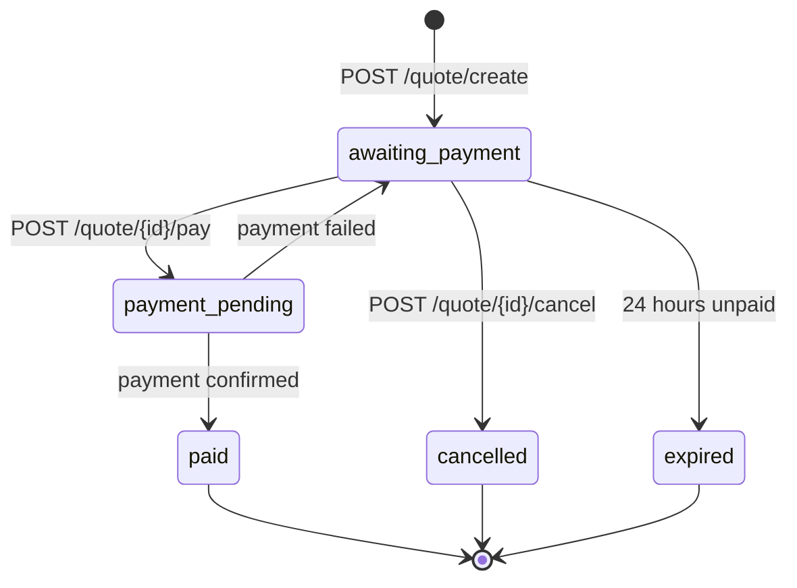

A quote prices one of your vehicles under a coverage. You have 24 hours to pay it. Once paid, it opens a contract.

## Quote status

| `status` | Meaning | What you can do |
| --- | --- | --- |
| `awaiting_payment` | Never paid, or every attempt failed. | [Pay](/api-reference/quotes/pay) or [cancel](/api-reference/quotes/cancel) it. |
| `payment_pending` | A payment is waiting for the payer to confirm in Wave. | Wait for it to settle. See [Payments](/guides/payments). |
| `paid` | Final. The payment opened the contract. | Follow the contract with `contractId`, or with [`GET /contract/quote/{quoteId}`](/api-reference/contracts/get-by-quote). |
| `cancelled` | Final. You cancelled it. | Nothing: create a new quote if you need one. |
| `expired` | Final. It was not paid within 24 hours. | Nothing: create a new quote. |

<Note>
  A paid quote's `status` stays `paid`. The contract has its own status (`pending`, `started`, `expired`): read it from the [contract](/guides/contracts#contract-status).
</Note>

## Expiry

Every quote has an `expires` timestamp, 24 hours after its `created`. A quote not paid by then expires:

- [`GET /quote`](/api-reference/quotes/list) leaves it out.
- [`GET /quote/{id}`](/api-reference/quotes/get), [`GET /quote/{id}/status`](/api-reference/quotes/status), [paying](/api-reference/quotes/pay) and [cancelling](/api-reference/quotes/cancel) it answer `410 quote_expired`.

The quote expires at `expires` exactly, not a few minutes later.

If a payment is waiting for the payer when the 24 hours run out, the quote does not expire yet. It stays `payment_pending` until the payment settles: `paid` if the payer confirms, `expired` if the payment fails.

A quote also cannot be paid after its `startDate`, even within its 24 hours. See [Quotes that cannot be paid](/guides/payments#quotes-that-cannot-be-paid).

## Cancelling a quote

[`POST /quote/{id}/cancel`](/api-reference/quotes/cancel) cancels a quote you no longer want paid, for example when your client changes their mind. A cancelled quote stays in [`GET /quote`](/api-reference/quotes/list) and can no longer be paid.

You can only cancel a quote that is `awaiting_payment`. While a payment is waiting for the payer, cancelling answers `409 payment_in_progress`: wait for the payment to settle. Cancelling a cancelled quote again changes nothing.
